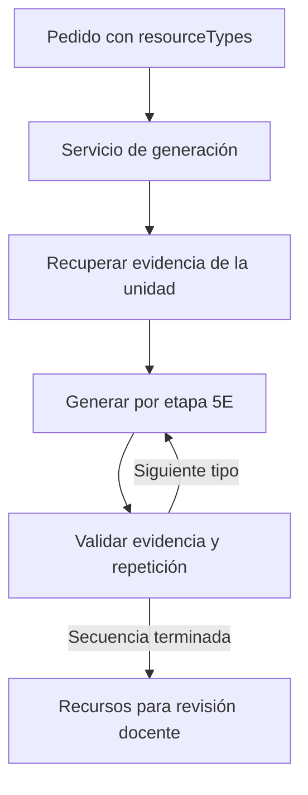

# Arquitectura y estado de la Plataforma Docente

Actualizado el 07/11/2026. El frontend y el backend se mantienen en repositorios independientes
y se comunican por HTTP según el contrato OpenAPI. El backend procesa el material en fragmentos,
recupera evidencia de la unidad y genera recursos textuales, multimedia e interactivos según el catálogo
y la configuración del servidor. El docente revisa y aprueba los recursos antes de exportarlos.

## Estado actual

El frontend usa React 18, TypeScript y Vite. El backend usa FastAPI y SQLAlchemy.
La recuperación de evidencia combina BM25 y búsqueda vectorial cuando pgvector y el proveedor de
embeddings están disponibles. La generación usa un modelo de lenguaje configurado o el generador
por reglas, según el proveedor y el resultado de la llamada. La revisión y el historial de descargas
se guardan en el servidor. TA-006 está cerrada. Según el registro de avance de Sergio en Notion,
se comprobó la importación de Moodle XML en Moodle y de SCORM 1.2 en Chamilo. En SCORM Cloud
se registraron 5 de 5 pruebas exitosas.

El modelo instruccional 5E sigue siendo la base: cada tipo de recurso pertenece a una etapa, que se envía al
backend y orienta la redacción. En la interfaz no se nombran las etapas; se muestran como momentos de la clase.

| Momento en la interfaz | Etapa 5E |
|---|---|
| Para iniciar la clase | Enganchar (*engage*) |
| Para explorar | Explorar (*explore*) |
| Para explicar | Explicar (*explain*) |
| Para aplicar | Elaborar (*elaborate*) |
| Para evaluar | Evaluar (*evaluate*) |

Los tipos disponibles los publica el [catálogo de recursos](../api/resource-catalog.md).
La fuente del catálogo es `domain/generation/resource_catalog.py`.

En «Elegir opciones» el docente marca uno o varios tipos en cada momento de la clase y se generan todos juntos. La
revisión los muestra agrupados en el mismo orden. Detalle de formatos, medios y respaldos en ADR-011.

HU-006: el frontend obtiene los tipos, etiquetas y metadatos mediante `GET /api/v1/resource-types`. La definición
única está en el dominio y también alimenta los formatos usados por los exportadores. Contrato, carga y reintento
en [Catálogo de recursos](../api/resource-catalog.md).

| Área | Funcionamiento actual | Límite |
|---|---|---|
| Cuentas y sesión | «Crear cuenta» con contraseña cifrada (PBKDF2) y sesión con token revocable de ocho horas | Sin recuperación de contraseña ni roles |
| Cursos y unidades | Creación, edición y borrado (con su material, recursos y descargas), con sumilla, logro y resultados de aprendizaje | Las unidades guardadas no se quitan de un curso; se borra el curso completo |
| Material | Archivo en la BD, extracción de PDF, PPTX y TXT, fragmentos de unas 220 palabras con su página, búsqueda por tema en Wikipedia en español. El docente no ve conteos de fragmentos: el documento queda «Listo para generar» | Los PDF escaneados (solo imágenes) no tienen texto; no hay OCR |
| Pedido | «Elegir opciones» (agrupadas por momento de la clase) o «Escribir pedido»: reglas que interpretan tipo, cantidad, dificultad, alternativas y resultado, y muestran lo entendido; el texto completo va como indicación | La interpretación del pedido escrito es por reglas, no por IA |
| Generación | Recuperación híbrida y redacción con IA (Gemini, Anthropic u OpenAI) o por reglas; solo se aceptan recursos con citas válidas. Cada recurso guarda una copia de su evidencia y los parámetros del pedido | Con `resourceTypes`, un agente por etapa redacta la secuencia sin repetir contenido (HU-003, ADR-013); el frontend aún pide los tipos uno por uno. Desde HU-016, `evidenceThreshold` se aplica al verificar las citas en `prompt_drafting.py`. |
| Revisión | En el servidor: aceptar, editar o descartar distractores (con motivo), aprobar con las mismas reglas que el backend, regenerar (la versión anterior pasa a «Descartados») y borrar | No hay «Aceptar todos» (decisión del equipo: se revisa uno por uno) |
| Descargas | Moodle XML (preguntas aprobadas) y paquete SCORM 1.2 para Chamilo (todos los recursos aprobados), armados en el backend; y el documento de la unidad (HTML) con su evidencia. Nombres con el curso y la unidad. Historial en el servidor, con «Borrar historial» | TA-006 cerrada: importación verificada en Moodle y Chamilo y 5 de 5 pruebas exitosas en SCORM Cloud, según el registro de Sergio en Notion. |

## Backend hexagonal

El backend vive en `backend/src/platform5e/` y sigue la arquitectura hexagonal (puertos y adaptadores) en tres capas.
La regla de dependencia apunta hacia adentro y la vigila `tests/architecture/test_layer_dependencies.py`; los nombres
en inglés los vigila `tests/architecture/test_english_names.py`.

```
backend/src/platform5e/
├── domain/                     Reglas puras, sin FastAPI ni SQLAlchemy
│   ├── accounts/               Errores de la cuenta y la configuración del docente
│   ├── generation/             Errores y catálogo de tipos por etapa y formato (resource_formats.py)
│   ├── materials/              Fragmentación (chunking.py) y búsqueda BM25 (text_analysis.py)
│   └── shared/                 Errores comunes (no encontrado, duplicado, persistencia no disponible)
├── application/                Casos de uso; solo conoce el dominio y sus puertos
│   ├── ports/outbound/         Puertos (typing.Protocol): repositorios, modelo de lenguaje, recuperación de evidencia,
│   │                           fuente abierta, exportador, medios (generar, guardar y dibujar)
│   ├── services/               accounts, materials, generation (redacción, generador por reglas) y review
│   └── use_cases/              export: lo aprobado de una unidad → archivo · media: gráfico, imagen o audio de un recurso
├── infrastructure/             Adaptadores
│   ├── http/                   Rutas FastAPI (routers/), esquemas Pydantic (schemas/), errores y autenticación
│   ├── persistence/            Repositorios SQLAlchemy (PostgreSQL en Neon o SQLite)
│   ├── llm/                    Gemini, Anthropic u OpenAI por HTTP, imágenes y voz con Gemini, y las fábricas
│   ├── retrieval/              Recuperación híbrida y BM25: adaptadores del puerto EvidenceRetrieverPort
│   ├── exporters/              SCORM 1.2 multirrecurso, Moodle XML y documento HTML (UnitExporterPort); gráficos SVG
│   │                           (VisualRendererPort)
│   ├── html_sanitizer.py       Limpieza del HTML del editor enriquecido (nh3)
│   ├── extraction/             Texto de PDF (pypdf), PPTX (python-pptx) y TXT
│   ├── sources/                Wikipedia en español (CC BY-SA 4.0)
│   └── settings.py             Variables de entorno
└── main.py                     Punto de composición: crea los adaptadores, los inyecta y registra las rutas
```

El dominio y la aplicación no leen variables de entorno ni importan frameworks: `main.py` lee la configuración, crea
los adaptadores y se los pasa a los servicios por constructor. Por eso las pruebas unitarias usan puertos falsos en
memoria y no necesitan base de datos ni red.

La recuperación usa `EvidenceRetrieverPort`. El punto de composición inyecta
`HybridEvidenceRetriever`, que combina BM25 y pgvector mediante *Reciprocal Rank Fusion* (RRF)
y acota la recuperación a la unidad. Si la búsqueda semántica no está disponible, no devuelve resultados
o falla el embedding de la consulta, usa el ranking BM25. EN-013 incorpora los embeddings y HU-011 la
recuperación híbrida. El límite de espera del embedding y la continuidad con BM25 se comprueban en
[`test_evidence_retrieval_i20.py`](../../backend/tests/unit/test_evidence_retrieval_i20.py).

## Orquestación de la generación por etapas

El backend implementa una **orquestación centralizada y secuencial**. Con un pedido que incluye
`resourceTypes`, [`GenerationService.generate_sequence`](../../backend/src/platform5e/application/services/generation/generation_service.py)
ordena los tipos por etapa 5E, recupera una vez la evidencia de la unidad y llama al generador por cada
tipo. Cada paso recibe un resumen de los recursos aceptados previamente. Si detecta repetición, reintenta
una vez y descarta lo que siga repitiéndose. [`sequence.py`](../../backend/src/platform5e/domain/generation/sequence.py)
contiene las reglas de orden y similitud. Las etapas se especializan por su contexto, instrucciones
y estructura de salida. El servicio reutiliza los adaptadores de generación configurados.



El flujo actual cabe en un servicio de aplicación con puertos para recuperación y generación.
Para la sustentación, esta es la justificación técnica de la implementación propia: el orden está
definido por 5E y las reglas de cada paso se pueden probar con adaptadores falsos. La lógica de
coordinación está en Python y no requiere un runtime de LangChain, LangGraph o CrewAI.
Las pruebas de [orquestación](../../backend/tests/unit/test_sequence_orchestrator.py) y de
[secuencia por HTTP](../../backend/tests/e2e/test_sequence_api.py) muestran el recorrido.
La selección múltiple actual del frontend usa pedidos individuales por tipo. Para demostrar la
secuencia compartida se debe usar el pedido con `resourceTypes` de la API.

Las cuentas se crean con `POST /api/v1/accounts` y se guardan con su sal y la huella PBKDF2 de la contraseña.
Opcionalmente, `main.py` pasa una cuenta inicial (`BOOTSTRAP_TEACHER_EMAIL` y `BOOTSTRAP_TEACHER_PASSWORD`).
`DEMO_CATALOG=true` (solo pruebas) activa la cuenta y el curso de ejemplo y las propuestas preparadas para unidades
sin material.

Un recurso solo queda «aprobado» si no hay distractores pendientes, hay al menos dos aceptados y una clave: la misma
regla que muestra la pantalla. La exportación usa solo lo aprobado y registra la descarga en el historial.

**Pendiente declarado (Sprint 2).** Los nombres de tablas y columnas de la base (`ep002_cursos`, `docente`…) y los
valores guardados (`pendiente`, `aprobado`, `item_opcion_multiple`, `intermedia`…) siguen en español: cambiarlos exige
migrar los datos de Neon. En el código, los atributos del ORM ya están en inglés y apuntan a esas columnas. Los cursos,
documentos y generaciones guardados antes del contrato en inglés se adaptan al leerlos. Ver
[technical-decisions.md](../decisions/technical-decisions.md).

## API y contratos

Swagger está en `/docs` y ReDoc en `/redoc` (en local, `http://localhost:8000/docs`); el contrato versionado está en
[openapi.json](../api/openapi.json) y lo regenera `python scripts/export_openapi.py` desde `backend/`. Cada operación
tiene resumen, descripción, modelo de respuesta y sus errores; `tests/integration/test_openapi_documentation.py`
falla si falta algo, si una ruta o una clave del JSON no está en inglés, o si el archivo versionado no está al día.

Autenticación: `POST /accounts` o `POST /sessions` devuelven un token; en Swagger se pega en *Authorize*
(esquema `TeacherSession`). Todos los errores tienen la forma `{"error": {"code": "UNIT_NOT_FOUND", "message": "…"}}`:
el código es estable y en inglés; el mensaje lo lee el docente y va en español.

| Ruta (prefijo `/api/v1`) | Operaciones |
|---|---|
| `/accounts` | POST crear la cuenta (abre la sesión) |
| `/sessions` y `/sessions/current` | POST iniciar sesión; GET docente en sesión; DELETE cerrar sesión |
| `/courses` y `/courses/{course_id}` | GET lista; POST crear; PUT editar; DELETE borrar con su material, recursos y descargas |
| `/documents` y `/documents/{document_id}` | GET lista; POST subir (multipart: `file` y `context`); DELETE borrar |
| `/documents/{document_id}/file` | GET archivo original |
| `/documents/{document_id}/process` | POST extraer el texto y crear los fragmentos |
| `/documents/{document_id}/chunks` | GET fragmentos del documento |
| `/documents/from-topic` | POST buscar el tema en Wikipedia y guardarlo como material procesado |
| `/generations` y `/generations/{generation_id}` | POST generar con el material de la unidad; GET historial; GET una generación |
| `/generator` | GET generador activo (modelo de lenguaje o reglas) |
| `/review-summary` | GET recursos aprobados y por revisar de cada unidad |
| `/units/{unit_id}/resources` y `/units/{unit_id}/resources/{resource_id}` | GET recursos con su revisión; PUT guardar la revisión (texto con formato y elementos editados); DELETE borrar |
| `/units/{unit_id}/resources/{resource_id}/media` | GET gráfico SVG, imagen o audio del recurso |
| `/units/{unit_id}/downloads` | GET historial; POST registrar una descarga; DELETE borrar el historial |
| `/units/{unit_id}/exports` | POST paquete SCORM para Canvas o Chamilo (`scorm_zip`), Moodle (`moodle_xml`) o documento (`documento`) |
| `/health` (sin prefijo) | GET comprobación de salud para Render |

Los contratos 5E (estructura de cada tipo de recurso) están en `backend/src/platform5e/infrastructure/http/schemas/`
(`engage.py` … `evaluate.py`). `python scripts/export_contracts.py` regenera sus JSON Schema en `docs/api/contracts/`
y `tests/unit/test_five_e_contracts.py` comprueba que un ítem sin evidencia se rechace.

## Frontend y puntos de integración

Rutas: `/login`, `/register`, `/courses` (Mis cursos), `/courses/new`, `/courses/:id`, `/courses/:id/edit` y
`/courses/:id/units/:unitId/:tab` (`materials`, `generation`, `review`, `export`). Sin sesión, las rutas
internas llevan a «Inicio de sesión» y luego regresan a donde estaba el docente.

El código está en `src/` del [repositorio frontend](https://github.com/Yansete/plataforma-5e-frontend).
Cada funcionalidad separa `api/`, `model/`, `components/` y `pages/` según corresponda.

| Parte | Qué hace |
|---|---|
| `shared/api/httpClient.ts` | Cliente HTTP: agrega la sesión, lee los errores `{error: {code, message}}`, distingue «sin conexión» de «tiempo agotado» y cierra la sesión vencida |
| `features/auth`, `features/courses` | Cuentas y sesión; cursos con borrado y resumen de recursos por unidad |
| `features/materials` | Subir, procesar y borrar documentos; buscar un tema en fuentes abiertas |
| `features/generation` | Formulario con selección múltiple por etapa y pedido escrito (interpretado por reglas); un `POST /generations` por tipo marcado |
| `features/review` | Revisión agrupada por etapa; editor enriquecido (Tiptap, se carga al editar); gráficos, imágenes, audio (con la voz del navegador de respaldo) y actividades; edición de sus elementos; regeneración y evidencia |
| `features/export` | Pide al backend el archivo para Moodle o Chamilo (`POST /units/{id}/exports`), descarga el documento de la unidad (HTML) generado por el servidor y muestra el historial |
| `features/units` | La página de la unidad con sus cuatro pestañas; los recursos se cargan una vez y las pestañas los comparten |
| `app/` | Rutas, sesión requerida y datos compartidos (`DataProvider`) |

La sesión se guarda en `localStorage` (`platform5e.session` (migra la clave anterior `plataforma-docente.sesion`)); los datos del docente viven en el servidor.
Una edición no aprueba un recurso: solo la acción «Aprobar recurso» lo vuelve descargable.

## Diseño y convenciones

El diseño de referencia está en `docs/design/ui-design-system.docx`. Se conservan tokens de
`src/styles/tokens.css` del frontend, componentes compartidos en `src/shared/components/ui.tsx` e iconos de trazo.
Fraunces se usa para títulos y Public Sans para texto. Hay etiquetas visibles, foco visible y controles de 44 px.
La barra lateral pasa a menú bajo 960 px. Los textos y comentarios se escriben en español.

El backlog y los acuerdos del equipo se consultan en Notion. Antes de programar una tarea,
registrar su alcance, criterios de aceptación y pruebas en `docs/specs/<tarea>/spec.md`,
y el orden de cambios en `plan.md`. Hay ejemplos en [HU-047](../specs/hu-047/) y
[HU-050](../specs/hu-050/). Las decisiones aceptadas se registran en
[technical-decisions.md](../decisions/technical-decisions.md).

## Persistencia y entorno

El backend usa SQLite por defecto y admite PostgreSQL con
`DATABASE_URL=postgresql+psycopg://...`. La URL `postgres://...` de `backend/.env.example` corresponde al entorno
de dbmate y no se utiliza directamente para SQLAlchemy. La configuración se establece en la terminal del backend.
Las dependencias del backend se definen en `backend/pyproject.toml`.

El entorno de EN-011 en `backend/database/` usa PostgreSQL 17 y pgvector 0.8.1, migraciones dbmate, fragmentos de 768
dimensiones e índices HNSW y GIN. Es distinto del almacenamiento que usa hoy el backend. Ver
[la guía de base de datos](../../backend/database/README.md). Las migraciones y `backend/database/schema.sql` no se modifican en esta limpieza.
No se editarán migraciones ya aplicadas; los futuros cambios de esquema requieren una nueva migración.

## Ejecución y verificación

Desde `backend/`, con Python 3.11 o superior:

```bash
python -m venv .venv
# PowerShell: .\.venv\Scripts\Activate.ps1
# Linux/macOS: source .venv/bin/activate
pip install -e ".[dev]"
uvicorn platform5e.main:app --reload --port 8000
```

Desde la raíz del repositorio frontend, en otra terminal:

```bash
npm ci
npm run dev
```

Comprobaciones antes de entregar:

```bash
# En el repositorio frontend
npm run typecheck
npm test
npm run build
npm run test:e2e          # levanta el backend (Python con el backend instalado) y Vite
# En backend/, con .venv activo
pytest
pytest tests/unit tests/architecture tests/integration --cov=platform5e.domain --cov=platform5e.application --cov-fail-under=80
```

Las pruebas e2e del backend usan HTTP y una BD temporal SQLite, o PostgreSQL si se define `E2E_DATABASE_URL`
para una base exclusiva de pruebas. No debe apuntar a datos de trabajo. Las pruebas de arquitectura analizan con AST
todos los archivos Python del backend.

Las capturas nuevas se generan en `test-results/` del repositorio frontend, excluido por Git, y se adjuntan a Notion.
Los informes de avance y las validaciones académicas también se conservan en Notion.

## Pendientes y límites

Queda por verificar el comportamiento con lectores de pantalla y completar las mediciones de rendimiento. Los PDF escaneados requieren una capa de texto para la extracción actual.
La validación docente RN-004 se realizó, según el registro del equipo. Queda por confirmar el seguimiento
de sus propuestas en el Sprint 2, en especial la correspondencia de las citas después de editar.

### Organización del frontend por funcionalidad

`src/app/` del repositorio frontend reúne los proveedores, las rutas y la protección de sesión.
`shared/` contiene el cliente HTTP, la sesión, los componentes, los hooks y los tipos compartidos.
`features/` agrupa `auth`, `courses`, `units`, `materials`, `generation`, `review` y `export`;
cada funcionalidad separa `api/`, `model/` y sus páginas o componentes según corresponda.
El alias `@/` apunta a `src/`. Los textos visibles permanecen en español.

La tarea 7 usa las rutas y contratos REST en inglés integrados en `main`. La API incluye
`approvalBlockers` en cada recurso generado, listado o actualizado: se calcula con la misma
regla que impide aprobarlo en el servidor y no se guarda en la base. El frontend presenta
esos motivos sin duplicar la regla de aprobación; conserva la validación de los formularios.

Los tres archivos (Moodle XML, SCORM y documento HTML) se solicitan con
`POST /api/v1/units/{unit_id}/exports`. El caso de uso verifica la unidad del docente,
selecciona sus recursos aprobados y registra la descarga una sola vez. El adaptador
`UnitDocumentExporter` conserva la plantilla del documento, el orden de las etapas,
las alternativas y las citas, escapando texto y admitiendo solo enlaces HTTP(S).
El navegador selecciona recursos, presenta el estado y descarga el archivo entregado
por el servidor. No construye el HTML ni decide si un recurso cumple las reglas pedagógicas.
Los textos visibles y los formatos existentes permanecen en español; los valores guardados
no se renombran y no se modifican las tablas ni las migraciones.
